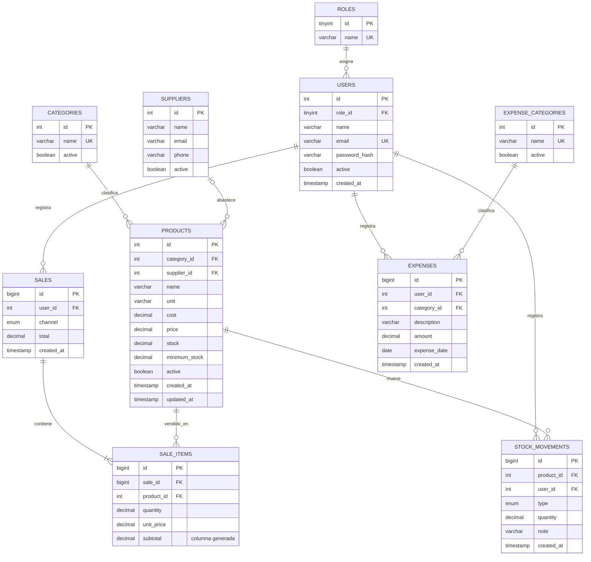

# Diagrama entidad-relación de StockFlow

Este diagrama describe el esquema final creado por `database/database.sql`. Las cardinalidades se expresan del lado de la entidad que participa en la relación; `supplier_id` es opcional en productos.

`sale_items.subtotal` es una columna generada por `ROUND(quantity * unit_price, 2)`; se conserva como dato consultable sin permitir que se desincronice del precio y la cantidad de la transacción.
